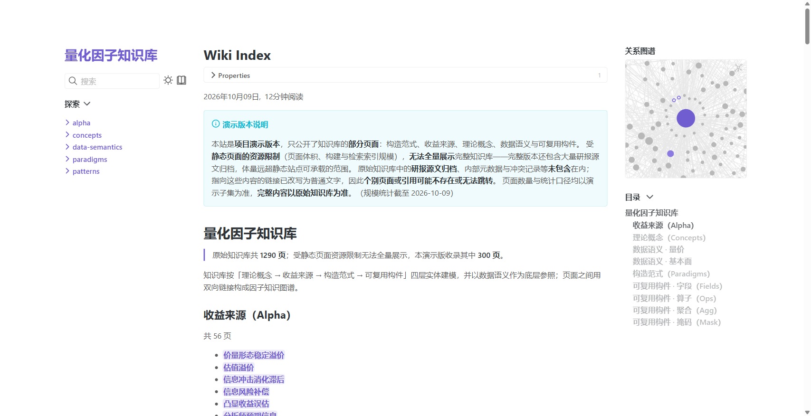
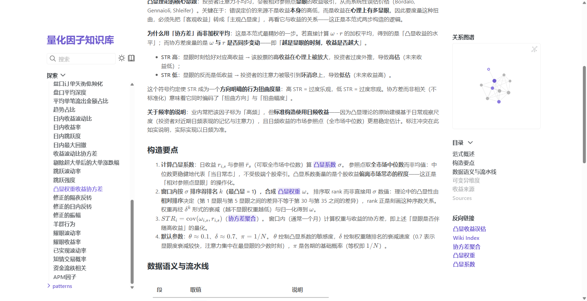
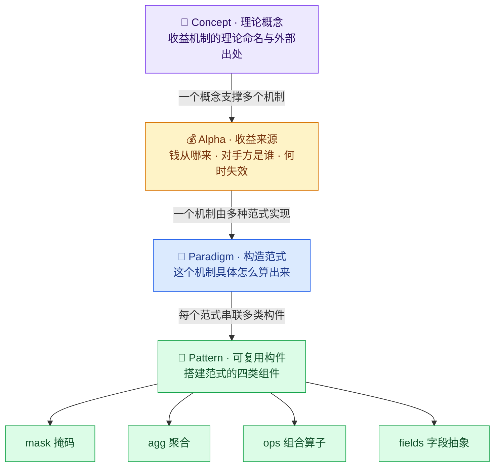
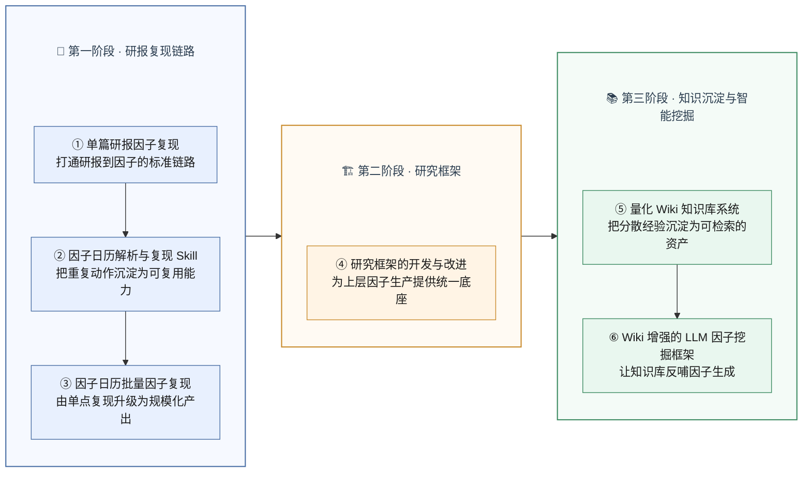

# 量化 Wiki 知识库系统

> 🌐 **在线演示**：<https://quant-wiki-showcase.pages.dev>
> 🛠️ **仓库维护手册**：[MAINTAINER_GUIDE.md](./MAINTAINER_GUIDE.md)（构建 / 脱敏 / 部署 / 排障）

**把量化研究里的「隐性知识」沉淀成一座结构化、可检索、可复利累积的因子知识库。**

研报里的构造方法、数据口径、理论出处、失败经验，散落在无数篇文档和每个人的脑子里——
重复造轮子、口径打架、人一走知识就丢。本系统把这些知识组织成一套可复用的知识资产引擎，
并封装为 MCP 服务，让团队用**自然语言**即可直接查询。

| 知识库首页 · 分层导航 | 知识页 · 构造范式示例 |
|---|---|
|  |  |

---

## 🎯 项目定位

| | |
|---|---|
| **服务对象** | 量化研究团队（研究员 / 因子开发者） |
| **解决什么** | 知识散落、口径不一、重复造轮子、经验随人流失 |
| **交付形态** | 结构化知识库 + 混合检索 + MCP 内部知识库服务 + 只读 CLI |
| **角色** | 独立设计并实现 |

---

## 🧠 核心设计：分层知识体系

系统最核心的设计，是把杂乱的因子知识组织成一套**自顶向下、层层落地**的层级结构：
从「凭什么赚钱」的理论概念，到「赚什么钱」的收益来源，再到「怎么算」的构造范式，
最后拆解为可复用的最小构件。

> **读法**：一个 Concept（理论概念）向下支撑多个 Alpha（赚钱机制）；一个 Alpha 可由多种
> Paradigm（构造范式）实现；每个 Paradigm 的流水线，最终由 `mask / agg / ops / fields`
> 四类 Pattern 组件**串联拼装**而成。

**两个基础层**同样重要：

- 📐 **data-semantics（数据语义）**：统一底层字段口径（如 `price_close`、`volume`），让不同频率、不同来源的数据能对齐；
- ⚠️ **Conflict（冲突页）**：当不同研报对同一因子的方向、成因给出**相互矛盾**的结论时，用冲突页显式记录分歧——不强行统一口径，而是把「这里有争议」本身沉淀下来，避免后人反复踩坑。

---

## 📊 规模与页面类型

系统把知识分为 7 类页面，每类承载明确职责。**全库累计 1290 页**：

| 页面类型 | 承载功能 | 页数 |
|---|---|---:|
| 🧠 **Concept**（理论概念） | 收益机制的理论命名与可追溯出处——回答「凭什么认为它成立」 | 44 |
| 💰 **Alpha**（收益来源） | 描述一笔可归因、可交易的收益——回答「钱从哪来、谁在亏、何时失效」 | 95 |
| 🔧 **Paradigm**（构造范式） | 一种具体的因子构造方法——回答「这个机制怎么算出来」 | 156 |
| 🧩 **Pattern**（可复用构件） | 最小可复用组件：`mask` / `agg` / `ops` / `fields` 四类 | 273 |
| 📐 **data-semantics**（数据语义） | 频率无关的底层字段口径，统一全库数据语言 | 33 |
| ⚠️ **Conflict**（冲突页） | 记录源之间的结论分歧与口径争议 | 4 |
| 📚 **source-docs**（源文档登记） | 研报 / 日历原文的溯源登记，不参与检索 | 683 |

> 其中真正进入检索、可被复用的**知识页共 601 页**——这构成了系统最核心的知识资产。

---

## 🛠️ 工程保障

- **可恢复事务化写入**：一次知识操作 = 一笔 `quant-wiki.transaction.v1` 事务，先 `inspect` 预检、确认后再 `apply`，**可审计、可回滚**，杜绝直接改 vault；
- **严格 Schema 校验**：统一 frontmatter 契约 + 页面间双向链接，写入前校验、拒绝非法结构；
- **链接健康检查**：自动检测死链，保证知识图谱长期一致、可维护；
- **只读检索与写入边界分离**：检索服务不提供写入能力，写入只走事务通道。

---

## 🔍 检索：混合召回 + 精排

内容召回采用自建 **BM25 + 向量 + Reranker** 三段式召回与精排：

- **候选生成**：关键词（BM25）与语义向量双路召回，再融合；
- **精排**：专用 Reranker 重排（可切换余弦级联精排）；
- **可配置**：召回 / 精排策略集中在配置文件，向量不可用时自动退化为纯 BM25，服务不中断；
- **退归页与源登记页不进索引**，避免污染检索结果。

---

## 🔌 MCP 内部知识库服务

知识库最大的价值不在「存」，而在「**被用起来**」。整套知识库被封装成一个
**MCP（Model Context Protocol）内部知识库服务**——团队任何人在编辑器里，用**自然语言**就能直接调用。

**它解决了什么：**

- **从「翻文档」到「问对话」**：不必知道文件在哪、叫什么名字，一句「搜一下大单净流入相关的反转范式」就能拿到结果；
- **开工前先避重**：新建因子前先查库，避免重复发明已存在的构造；
- **团队级共享**：服务部署在内网，多人可同时查询、互不影响，把个人经验变成**团队公共能力**。

**服务概况：**

| 项 | 说明 |
|---|---|
| 服务形态 | MCP 内部知识库服务，面向团队内部查询使用 |
| 工具数量 | **13 个**（检索 / 精读 / 大纲 / 反链 / 相似页 / 字段派生 / 流水线等） |
| 并发能力 | 同时支持 **12+** 路检索，超出排队不互相阻塞 |
| 典型用法 | 检索 → 看大纲 → 精读某节 → 扩展关联页，一条链路走完 |

**13 个工具能力一览：**

| 能力 | 工具 | 说明 |
|---|---|---|
| 🔍 检索 | `wiki_query` / `wiki_read` | 自然语言混合检索（关键词 + 语义向量 + 精排），支持按页类 / 标签过滤 |
| 📖 精读 | `wiki_get_page` / `wiki_outline` / `wiki_get_section` | 按页读全文、先看大纲、或精确读某一小节 |
| 🕸️ 关联 | `wiki_backlinks` / `wiki_outlinks` / `wiki_similar` | 查反向链接、出链、向量相似页，扩展探索 |
| 🧭 辅助 | `wiki_identity` / `wiki_fields` / `wiki_pipeline` | 防重名身份清单、字段派生面板、范式流水线摘要 |
| 🩺 健康 | `wiki_stats` / `wiki_health` | 库统计与索引健康诊断 |

**典型一条链路：**

---

## 🗺️ 在整体项目中的位置

本系统属于实习工作「知识沉淀与智能挖掘」阶段，与研报因子复现、研究框架、LLM 因子挖掘共同构成一条完整链路：

---

## 🧰 技术栈

| 类别 | 选型 |
|---|---|
| 语言 / 核心 | Python（标准库核心，无重框架依赖） |
| 服务 | MCP 服务（`mcp` + `uvicorn`） |
| 检索 | 自建 BM25 + 向量索引 + Reranker 精排（向量模型 `embedding-3`，2048 维） |
| 配置 / 契约 | YAML（`host-env` / `retrieval-config` / `mcp` config） |
| 知识载体 | Obsidian Flavored Markdown（wikilink / callout / 扁平 frontmatter） |

---

## 🙈 关于本仓库与保密

- 本仓库是知识库的**展示站**（Quartz v5 静态站），内容为**脱敏后的演示子集**（收录 300 页）；
- **不包含**完整知识库、源文档原文与引擎代码；`source-docs/`、内部元数据与冲突记录**均未公开**；
- 指向未收录页的链接已降级为纯文本，避免变相公开；
- 站点为 `noindex`，不参与搜索引擎收录。

> 构建 / 脱敏 / 抽稀 / 部署的完整流程见 [MAINTAINER_GUIDE.md](./MAINTAINER_GUIDE.md)。

---

## 📄 License

站点构建基于 [Quartz v5](https://github.com/jackyzha0/quartz)（MIT，见 `LICENSE.txt`）；
`quartz/` 为上游代码。知识库内容版权归作者所有，仅作项目展示。
