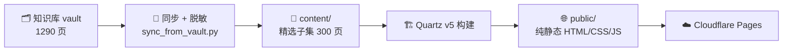

# QuantKnowledgeVault · 量化因子知识库展示站

> 🌐 **在线预览**：<https://quant-wiki-showcase.pages.dev>
> 📘 维护 / 构建手册：[MAINTAINER_GUIDE.md](./MAINTAINER_GUIDE.md)

把量化研究中的**隐性知识**——研报里的构造方法、数据口径、理论出处、失败经验——沉淀成
一座**结构化、可检索、可复利累积**的因子知识库，并把它发布成一个只读的
**Obsidian 风格静态站**用于对外展示。本站是知识库的**演示子集**（脱敏 + 抽稀后发布）。

---

## ✨ 这是什么

一个**因子知识引擎**的可视化门面。底层知识库把因子知识组织成四层实体 +
两个基础层，本仓库负责「**把其中可公开的部分抽出来 → 脱敏 → 构建成静态站**」。



---

## 🧠 知识库：分层知识体系

系统最核心的设计，是把杂乱的因子知识组织成一套**自顶向下、层层落地**的层级结构：
从「凭什么赚钱」的理论概念，到「赚什么钱」的收益来源，再到「怎么算」的构造范式，
最后拆解为可复用的最小构件。

| 层级 | 回答的问题 | 规模 |
|---|---|---:|
| 🧠 **Concept**（理论概念） | 凭什么认为它成立（收益机制的理论命名与外部出处） | 44 |
| 💰 **Alpha**（收益来源） | 钱从哪来、谁在亏、何时失效 | 95 |
| 🔧 **Paradigm**（构造范式） | 这个机制具体怎么算出来 | 156 |
| 🧩 **Pattern**（可复用构件） | 搭建范式的四类组件：`mask` / `agg` / `ops` / `fields` | 273 |
| 📐 **data-semantics**（数据语义） | 频率无关的底层字段口径，统一全库数据语言 | 33 |
| ⚠️ **Conflict**（冲突页） | 记录源之间的结论分歧与口径争议 | 4 |

> 全库累计 **1290 页**，其中进入检索的**知识页 601 页**，另登记 **683 篇**源文档
> （研报、因子日历等多来源）。一个 Concept 支撑多个 Alpha；一个 Alpha 可由多种
> Paradigm 实现；每个 Paradigm 由 `mask / agg / ops / fields` 四类 Pattern 串联拼装。

---

## 🔍 能力：知识库如何被用起来

- **混合检索**：自建 `BM25 + 向量 + Reranker` 三段式召回与精排（策略可配置，向量不可用时自动退化为纯 BM25）。
- **事务化写入**：一次知识操作 = 一笔可恢复事务（`inspect → apply`，可审计、可回滚），配套 YAML schema 校验与死链检查。
- **MCP 服务**：整套知识库封装为 MCP 只读服务（13 个工具，支持内网多人并发），可在编辑器中用自然语言直接检索。
- **可复利累积**：新挖因子回写知识库形成闭环，库越用越厚。

---

## 🛠️ 技术栈

| 类别 | 选型 |
|---|---|
| 站点引擎 | [Quartz v5](https://quartz.jzhao.xyz/)（MIT） |
| 运行时 | Node.js ≥ 22 |
| 同步 / 自检脚本 | Python ≥ 3.10（仅标准库） |
| 部署 | Cloudflare Pages（纯静态，含 Web Analytics） |
| 构建产物 | HTML / CSS / JS / JSON，不含 vault 源文与引擎代码 |

---

## 🚀 本地运行

```bash
npm install                                   # 安装依赖（首次）
python scripts/sync_from_vault.py             # 从 vault 同步 + 脱敏（只读 vault）
npx quartz build --serve --port 8080          # 本地预览 → http://localhost:8080
```

---

## 📁 目录结构

```text
README.md                     项目介绍（本文）
MAINTAINER_GUIDE.md           维护手册：脱敏 / 抽稀 / 部署 / 排障（详见）
content/                      同步生成的待发布内容（vault 的精选子集，可重建）
public/                       构建产物（纯静态，可直接上传）
quartz/                       Quartz 引擎（上游代码）
quartz.config.yaml            站点配置：标题、主题配色、插件开关
scripts/sync_from_vault.py    同步 + 脱敏（只读 vault）
scripts/verify_build.py       上线前自检
```

---

## 🔐 安全边界

- **只读 vault**：同步脚本只读 `wiki/`，写的是本仓库的 `content/`，绝不修改 vault。
- **白名单发布**：frontmatter 只保留声明的字段，其余（本机绝对路径 `locator`、内部 id、`stage` 等）整段剥除。
- **非公开目录降级**：指向 `source-docs/`、`meta/` 的链接降级成纯文本，既避免死链，也不变相公开研报目录。
- **上线前自检**：`verify_build.py` 会拦下 `.md` 泄漏、本机绝对路径、死链、搜索索引里的 frontmatter 泄漏。
- **防收录**：`robots.txt`（`Disallow: /`）+ `_headers`（`X-Robots-Tag: noindex`）。

> ⚠️ 本站是**演示子集**（未公开 `source-docs` 等），页面数量与统计口径以子集为准，
> 完整内容以原始知识库为准。

---

## 📄 License

站点构建基于 [Quartz v5](https://github.com/jackyzha0/quartz)（MIT，见 `LICENSE.txt`）；
`quartz/` 与 `docs/` 为上游代码与文档。知识库内容版权归作者所有，仅作项目展示。
